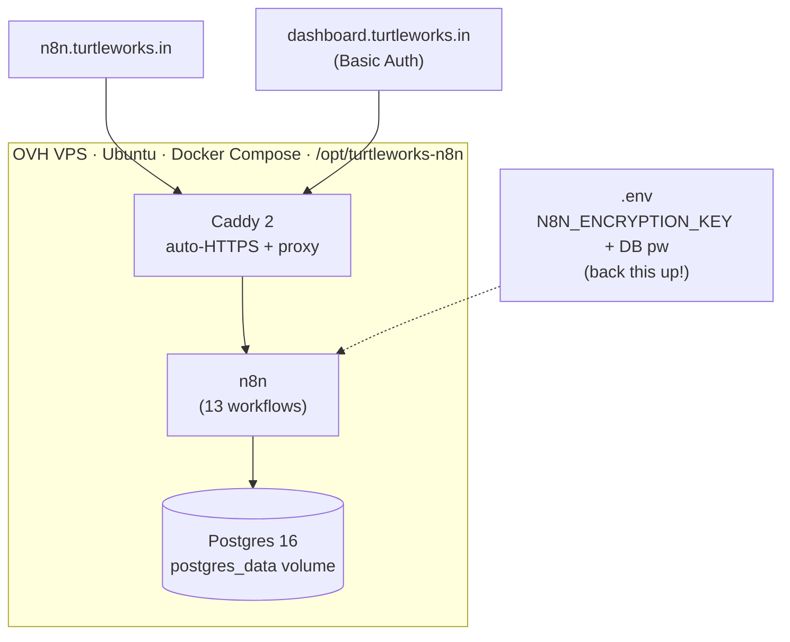
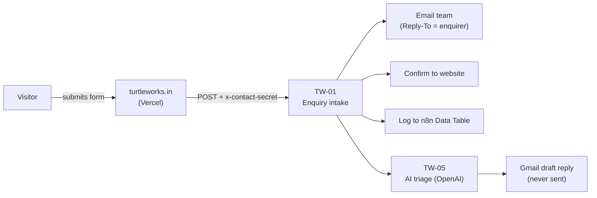
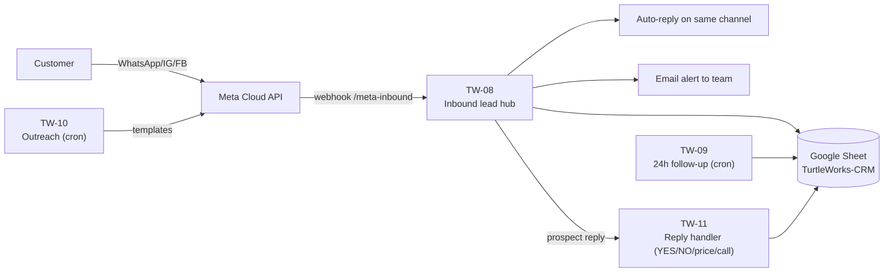
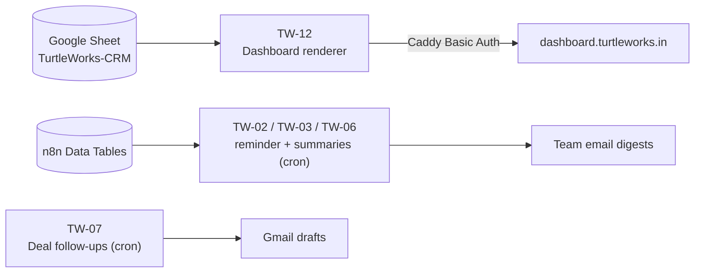

# TurtleWorks — System Architecture

How the TurtleWorks website and automation suite fit together: the components,
where each lives, and how a lead travels through the system.

- **Website:** Next.js 16 + Tailwind v4, deployed on **Vercel** → `turtleworks.in`
- **Automation hub:** self-hosted **n8n** on an **OVH VPS** → `n8n.turtleworks.in`
- **CRM store:** Google Sheet **TurtleWorks-CRM** (+ legacy n8n Data Tables)
- **Dashboard:** n8n-rendered → `dashboard.turtleworks.in`

---

## 1. Components

| Layer | Component | Where it runs | Purpose |
|---|---|---|---|
| Front door | **Website** (Next.js 16, Tailwind v4) | Vercel (`turtleworks.in`) | Marketing site + enquiry form |
| Intake | **Contact webhook** | `POST n8n.turtleworks.in/webhook/turtleworks-contact` (header `x-contact-secret`) | Receives website enquiries |
| Orchestration | **n8n** (13 workflows) | OVH VPS, Docker | Runs every automation 24/7 |
| Database | **Postgres 16** | OVH VPS, Docker volume | n8n's own data (executions, workflows) |
| TLS / proxy | **Caddy 2** | OVH VPS, Docker | Auto-HTTPS + reverse proxy for both subdomains |
| CRM store | **Google Sheet "TurtleWorks-CRM"** | narendra@turtleworks.in Drive | Leads / Log / Prospects / Outreach Log |
| Legacy store | **n8n Data Tables** | n8n | Website leads (`Leads`), deals (`Deals`) — used by reports |
| Messaging | **WhatsApp Cloud API** | Meta | Inbound + outbound WhatsApp (number +91 79898 89116) |
| AI | **OpenAI API** | OpenAI | TW-05 triage + draft replies |
| Email | **Gmail (OAuth2)** | Google | Team alerts + saved drafts (never auto-sends) |
| Dashboard | **TW-12 renderer** | n8n → `dashboard.turtleworks.in` (Caddy Basic Auth) | Live pipeline view |

### Infrastructure (OVH VPS `15.204.90.176`)

> The **encryption key** in `/opt/turtleworks-n8n/.env` is fixed from first boot.
> Losing it makes every stored credential unreadable. Back that file up.

---

## 2. Data flow — website enquiry

The website waits up to 8 s for TW-01, so the team email + site confirmation
return first; logging and AI triage finish after the response.

---

## 3. Data flow — WhatsApp / inbound lead hub

Dedup rules live inside the flows: every lead gets a unique ID
(`WA-YYYYMMDD-XXXX`); **YES** keeps a prospect active, **NO** sets
`Do Not Contact` so they are never re-contacted.

---

## 4. Data flow — dashboard & reports

The dashboard renders **server-side on each load** — always current, with an
"Updated … IST" stamp at the top.

---

## 5. Key identifiers (non-secret)

| Thing | Value |
|---|---|
| VPS IP | `15.204.90.176` (OVH, Oregon) |
| n8n | `https://n8n.turtleworks.in` |
| Dashboard | `https://dashboard.turtleworks.in` (Basic Auth) |
| CRM Sheet ID | `1OGKDalTvCRJDad3iMnRhYLQWJA8zNDZXiGiI5Vi8ipo` |
| WhatsApp number | +91 79898 89116 · Phone Number ID `1283289098210230` |
| WABA ID | `1460213609344245` |
| Meta app | TurtleWorks n8n (`1432326073288423`) |
| Meta webhook | `…/webhook/meta-inbound` (field: `messages`) |

**Secrets** (encryption key, DB password, API tokens, dashboard password) live
only on the VPS `.env`, in n8n credentials, and the team password manager —
**never in this repo**. See [operations-runbook.md](operations-runbook.md).

For the per-flow catalogue see [n8n-flows.md](n8n-flows.md).
